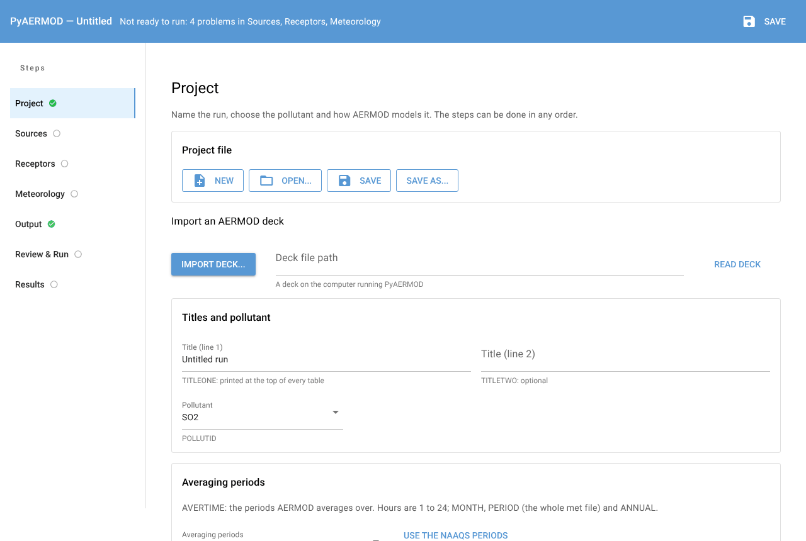
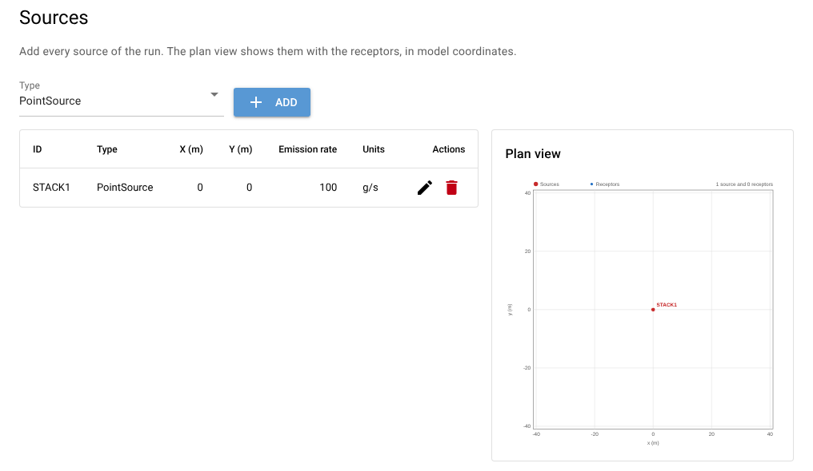
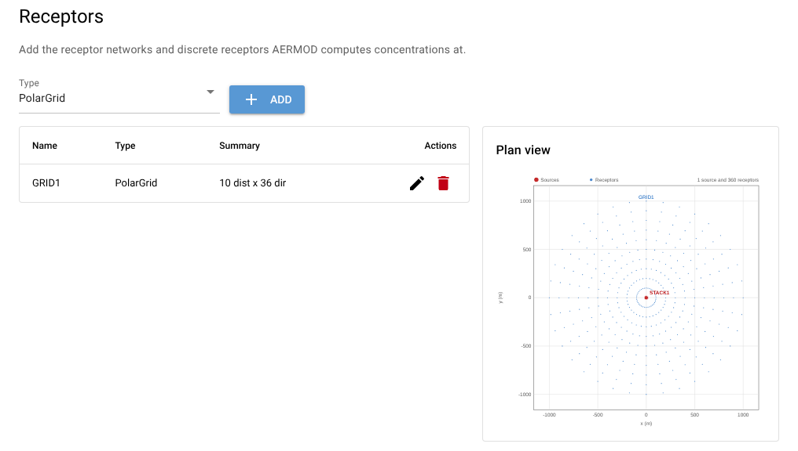
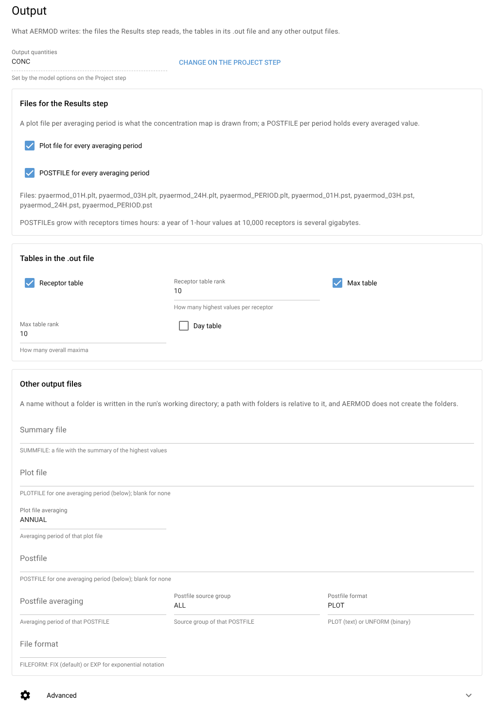
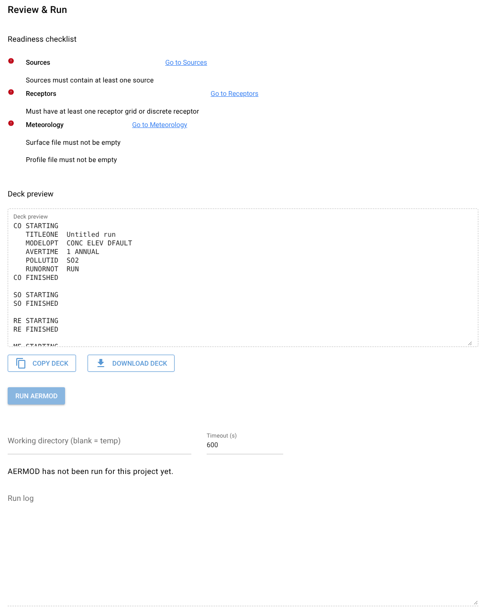
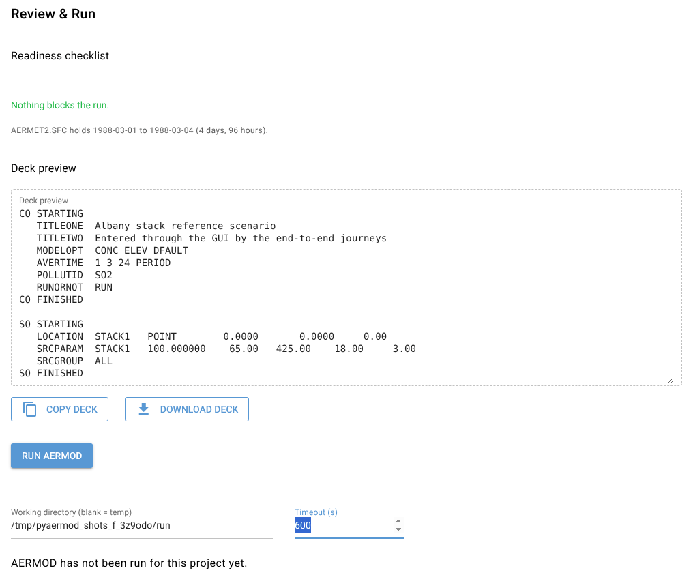
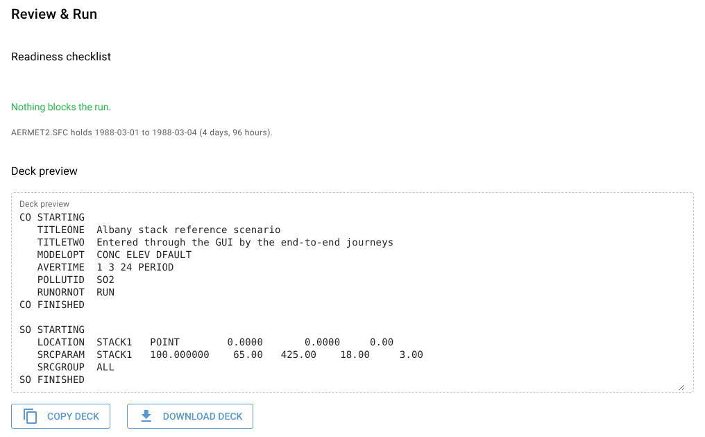
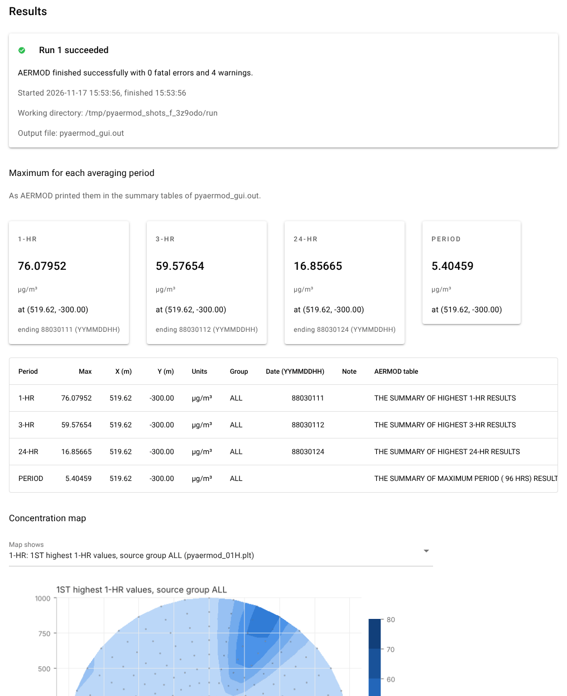
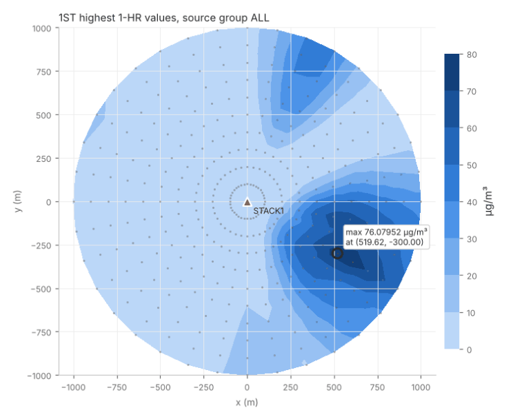

# GUI User Guide

PyAERMOD ships an interactive GUI built on [NiceGUI](https://nicegui.io).
The same codebase runs in two modes:

- **Browser tab** via `pyaermod-app` — the NiceGUI server runs on
  loopback. Best for development, multi-user / server deployments,
  and remote access.
- **Native desktop window** via `pyaermod-desktop` — wraps the same
  app in a [pywebview](https://pywebview.flowrl.com/) shell, for those
  who would rather not have it in a browser. See
  [Desktop Window](desktop.md).

To try the GUI without installing anything, the documentation site has
[an app with the same seven steps](browser.md#the-app) that runs pyaermod
and AERMOD (compiled to WebAssembly) in the browser. It opens the same
project files. It is not for regulatory use and cannot run AERMET or
AERMAP.

## Install

```bash
pipx install "pyaermod[gui]"       # or: uv tool install "pyaermod[gui]"
pyaermod-app
```

[Install](install.md) has every way to install the GUI (pip, pipx, uv,
conda) and what to do when an install fails.

## Launch

```bash
pyaermod-app           # opens a browser tab at http://127.0.0.1:8080
pyaermod-desktop       # opens a native OS window on a free port
```

`pyaermod gui` and `python -m pyaermod.gui_v2` are other spellings of
`pyaermod-app`, with the same options. Stop the app with Ctrl+C in the
terminal that started it.

`pyaermod-app` takes `--port` (when 8080 is in use), `--no-browser` (serve
without opening a tab) and `--host`. The default host, 127.0.0.1, serves
this computer only. The GUI reads and writes files and runs AERMOD as the
user who started it, for anyone who can reach it, so pass
`--host 0.0.0.0` only in a container or on a network you trust; the
repository's `Dockerfile` does, and its header shows how to publish the
port on 127.0.0.1.

## The AERMOD binary

The GUI runs the `aermod` executable it finds on your `PATH`; it does
not ship one. Install AERMOD from
[EPA SCRAM](https://gaftp.epa.gov/Air/aqmg/SCRAM/models/preferred/aermod/)
separately. When the executable is not found, the Review & Run step's
readiness checklist says "No 'aermod' binary on PATH. Install AERMOD and
re-launch." and the **Run AERMOD** button stays disabled.

## Layout

Both modes share one layout:

- a **header** with the project's name (the file it was opened from or
  saved to, or the deck it was imported from, or "Untitled"), a
  "(modified)" marker while there are unsaved changes, a one-line
  readiness summary and a **Save** button;
- a **step list** on the left with seven steps. Below a window width of
  1024 px the list is a drawer that the menu button ("Steps") in the
  header opens;
- the current **step**.



| Step | What it is for |
|---|---|
| **Project** | New / Open / Import deck / Save / Save As; the titles, pollutant, averaging periods and model options |
| **Sources** | Add, edit and delete sources of any of the 13 AERMOD source types |
| **Receptors** | Cartesian grids, polar grids and discrete receptors |
| **Meteorology** | The AERMET surface and profile files, the stations and the period to model |
| **Output** | The files the Results step reads, the tables in the `.out` file, other output files |
| **Review & Run** | The readiness checklist, warnings, a deck preview, and the run itself with progress and Cancel |
| **Results** | Per-period maxima, every summary table, the concentration map, the NAAQS comparison, downloads and the run history |

The steps can be done in any order; the order is guidance, not a gate.

### Status badges

Each step's badge reads **not started**, **error**, **warning** or
**complete**, from the validator's findings for the part of the project
that step edits (for Review & Run and Results, from the latest run that
was not cancelled). The project is checked again shortly after every
change, met files included, so the badges and the header's readiness
line ("Ready to run", or "Not ready to run: *N* problems in Sources,
Meteorology") follow your edits.

### Sessions and browser tabs

Each browser tab keeps its own project, in the server's memory.
Reloading the tab brings back the project, the step you were on and the
run history. Closing the tab or stopping the server discards unsaved
changes, so save before you do. A duplicated tab gets its own copy of
the project.

## Project

The Project step has these sections.

**Project file** — **New** starts from the blank project (title
"Untitled run", SO2, averaging periods 1 and ANNUAL, elevated terrain, a
plot file and a POSTFILE for every period). **Open...** reads a saved
`.json` project, checking it first: a file that cannot be read is
refused with "Load failed: ..." and nothing is replaced. **Save** writes
back to the project's file when it has one on disk, and otherwise acts
as **Save as...**, which downloads the file in the browser or asks where
to save it in the desktop app. Saving refuses a project its file could
not be reopened with ("Save failed: ..." names the field). New and Open
ask before they discard unsaved changes or stop a run in progress. The
file format (`pyaermod.gui_v2.project_io`) is versioned, so files from
earlier versions still open.

**Import an AERMOD deck** — **Import deck...** reads an existing `.inp`
deck into the project, replacing it without asking, so save first. In
the browser the deck is uploaded and brings none of the files it names;
one whose paths lead outside its own folder is refused, with those paths
listed. In the desktop app, or with **Deck file path** and **Read deck**
in either mode, the deck is read where it is, and the met, ozone and
`INCLUDED` files found beside it get their full paths. An **import
notice** then lists the lines kept as written (written back on every run
and save, but not editable in any step), the input files found, and
pickers for the met files that were not. The imported project has no
file yet; the header shows the deck's name.

**Recent files** — up to ten projects and decks opened, saved or
imported by a path on this computer, newest first; a click reopens one.
The list lives in `~/.pyaermod/recent_files.json`
(`PYAERMOD_RECENT_FILES` overrides it).

**Titles and pollutant** — the two title lines (TITLEONE, TITLETWO) and
the pollutant (POLLUTID). A pollutant from an imported deck that the
list does not know stays available as a choice.

**Averaging periods** — a multi-select of AERMOD's periods (1 to 24
hours, MONTH, PERIOD and ANNUAL) shown in AVERTIME's order. **Use the
NAAQS periods** selects the periods the chosen pollutant's standards
use, when pyaermod's table has them; a hint names them and says which
periods need complete years of met data.

**Model options** — what AERMOD computes (CONC, DEPOS, DDEP, WDEP), the
terrain (FLAT, ELEV, or FLAT ELEV for elevated terrain with some
sources flat), the regulatory default options (DFAULT) and, under
"Urban dispersion (URBANOPT)", the urban population, area name and
roughness. Deposition also needs each source's deposition parameters,
which the GUI cannot enter yet: they come only from an opened or
imported project.

## Sources

Choose a **Type** and click **Add** to open the editor for a new source,
or use the **Edit** and **Delete** buttons on a row of the table. The
13 types are PointSource, VolumeSource, AreaSource, AreaCircSource,
AreaPolySource, LineSource, RLineSource, RLineExtSource,
BuoyLineSource, OpenPitSource, PointCapSource, PointHorSource and
SidewashPointSource.

The editor is a dialog titled "Edit *Type* — *id*". The fields AERMOD's
LOCATION and SRCPARAM cards need come first; everything else (base
elevation, building downwash dimensions, source groups, urban flags,
deposition parameters, barriers and so on) is under **Advanced**.
Labels carry units ("Stack temp (K)") and the inputs show the field's
help text. **Save** applies your changes and **Close** discards them;
a source you add appears in the table only once you save it. A new
source starts from placeholder values (a 10 m stack emitting 1 g/s at
the origin, for a point source) that you override before saving.

The table lists each source's ID, type, coordinates, emission rate and
units, 25 rows per page with Previous and Next page buttons. While the
project has no sources it says "No sources yet. Choose a type and click
Add."

Beside the table a **plan view** plots the sources and receptors in
model coordinates and updates after every change.



## Receptors

The Receptors step mirrors Sources: a **Type** select with
CartesianGrid, PolarGrid and DiscreteReceptor, an **Add** button, a
table with **Edit** and **Delete** on every row (Name, Type, Summary
such as "21 x 21" or "10 dist x 36 dir"), one page of rows at a time,
and the plan view. The editor is the same generated form, with
elevations, hill heights and flagpole heights under **Advanced**.

A new polar grid starts as `GRID1` at the origin with 10 rings from
100 m in 100 m steps and 36 directions from 0° in 10° steps; a new
Cartesian grid as a 21 by 21 grid at 100 m spacing from (-1000,
-1000); a new discrete receptor at the origin.



## Meteorology

Meteorology is one block per project, so there is no table here.

**Met files** — the surface and profile files AERMET wrote. Each is a
full-width path field that says under itself when the path is not a
file on this computer, is relative (AERMOD reads a relative path from
the run's working directory), or starts with `~`, which AERMOD does not
expand. In the desktop app a **Browse...** button opens a native file
dialog. Below the files, the step says what the surface file holds, as
the next run would read it: the period it covers, the surface and
upper-air station IDs in its header and the first year of its data.
When ANNUAL is among the averaging periods and the file holds less than
a year of data, a warning says so (AERMOD would stop the run with E480)
with a button, "Change the averaging periods on the Project step".

**Stations** — SURFDATA, UAIRDATA and PROFBASE: the surface and
upper-air station IDs, the data start year and the profile base
elevation, which AERMOD checks against the files.

**Period to model** — STARTEND: the start and end year, month, day and
hour. Leave blank to model every hour of the files.

Everything else in the meteorology pathway is under **Advanced**.

## Output

What AERMOD computes (concentration, deposition) is a model option on
the Project step; the Output step shows it read-only, with a "Change on
the Project step" button.

**Files for the Results step** — two check boxes, both on by default: a
**plot file for every averaging period**, which the concentration map
is drawn from, and a **POSTFILE for every averaging period**, which
holds every averaged value and is what a NAAQS design value is computed
from. The file names follow the averaging periods and are listed below
the boxes. POSTFILEs grow with receptors times hours: a year of 1-hour
values at 10,000 receptors is several gigabytes.



**Tables in the .out file** — the receptor table, maximum table and
day table options and their ranks.

**Other output files** — the summary file, a single plot file or
POSTFILE with its averaging period, source group and format, and the
file format. A name without a folder is written in the run's working
directory; a path with folders is relative to it, and AERMOD does not
create the folders.

The rest of the output pathway is under **Advanced**.

## Review & Run

The Review & Run step reviews the project before AERMOD sees it.

**Readiness checklist** — every problem that would stop the run, grouped
by the step that fixes it, each with a "Go to *Step*" link. **Run
AERMOD** stays disabled until the checklist is empty, when the step says
"Nothing blocks the run."



Besides the validator's errors and a project that cannot be written as a
deck, the checklist catches what would make AERMOD itself stop: no
`aermod` binary; a met file whose path starts with `~`, which AERMOD
does not expand; a met file given by a relative path while the working
directory is blank (a new, empty folder); and an output file in a folder
that will not exist where AERMOD runs, since AERMOD creates no folders
(E500). An imported deck with `../plotfiles/X.PLT` paths shows the last
until the working directory is set to a folder that has them.

**Before you run** — the warnings that do not stop the run, among them
ANNUAL with less than a year of met data (which AERMOD would abort with
fatal error E480; this item links to both Meteorology and Project) and
a surface file that could not be read. A line below says what the
surface file holds.

**Deck preview** — a read-only view of the deck the run will use, with
**Copy deck** and **Download deck**. While the checklist has an item
that stops the deck being written, the preview says so instead.



**Run options** — the **working directory** (blank means a new temporary
folder for each run) and the **timeout** in seconds (600 by default).
These belong to the session, not to the project, and are not saved in
the project file. The deck is written into the working directory as
`pyaermod_gui.inp`, and AERMOD runs there.

**The run** — AERMOD runs in the background, so the other steps, and
other browser tabs, stay usable. A progress bar follows AERMOD's day
count against the days in the surface file ("Day 62 of 1988 (2 of 4
days)"), next to the elapsed time and a **Cancel** button, which is
offered once AERMOD has printed its first line. The status line reads
"Running AERMOD in ...", then "Succeeded in *N* s. See the Results
step.", "Failed: *reason*" or "Cancelled after *N* s." After a run the
step says how many fatal errors, warnings and informational messages
AERMOD reported and lists them in a table (severity, pathway, code,
input line and text). Codes with an entry in
[Common AERMOD errors](common-errors.md) link to it. A **Run log** shows
the end of AERMOD's standard output and error streams.



A second click on Run AERMOD while a run is in progress is ignored. New
or Open during a run asks first and then stops the run, and stopping the
server stops AERMOD too: no `aermod` process outlives the GUI.

## Results

The Results step shows one run of the session: the newest run AERMOD
completed, or an earlier one chosen from the run history. A run's files
are read once, in the background, when it finishes; if they cannot be
read the step says why and offers **Try reading again**.

**Run history** — when the session has more than one completed run, a
**Run shown** select lists them ("Run 2, finished 14:03:12: succeeded")
and reopens the one you pick. A run's values stay available after a
later run in the same working directory has overwritten its files; the
step says so, and that run's downloads are disabled. New and Open clear
the run history.

**Status** — a card with the verdict ("Run 2 succeeded"), AERMOD's
message counts, the start and finish times, the working directory and
the name of the `.out` file. A failed run shows no numbers: the step
says that AERMOD did not complete the run, lists AERMOD's fatal errors,
and offers only the deck and the `.out` file for diagnosis.

For a successful run the step shows, from AERMOD's own summary tables:



- **Maximum for each averaging period** — a card per period with the
  maximum as AERMOD printed it, its units, the receptor where it
  occurred and the date it ended, and a table with the same rows plus
  the source group and the AERMOD table the value came from. A value
  AERMOD flagged for calm hours (`c`), missing hours (`m`) or both
  (`b`) carries a note. A period whose only table is one of AERMOD's
  design-value tables (the 8th-highest, say) is labelled with that
  rank, because its value is that rank's, not the maximum. Deposition
  runs get a "Deposition: highest value of each averaging period"
  table.
- **Concentration map** — filled contours drawn from one of the run's
  plot files, with the sources and the highest value marked; a **Map
  shows** select picks the plot file when there is more than one. A
  run that wrote no plot files says so, with a button to the Output
  step. The map is a picture of the numbers in the tables beside it.

  
- **Comparison with the NAAQS** — one row per standard of the
  pollutant: its level, this run's value and where, and the result. The
  value is AERMOD's own design-value table where there is one, else a
  design value computed from the period's POSTFILE (one over 100 MB is
  not read), else, as a screen, the period's highest value, which no
  design value can exceed.
- **Summary tables** — every rank of every table in the `.out` file
  (group, rank, value, note, date, receptor coordinates, receptor type
  and network), one expandable table per period and output type.
- **Sources** — the sources AERMOD listed for the run.
- **Downloads** — the deck, the `.out` file, every plot file and every
  POSTFILE, with their paths on disk. Below them, **Download KMZ** writes
  the sources and the values of the plot file shown on the map for
  Google Earth; it asks for the UTM zone of the model coordinates and
  whether they are in the southern hemisphere, and needs pyproj
  (`pip install pyproj`).

## Tips

- Save your project at every checkpoint. Reloading the browser tab
  restores it, but closing the tab or stopping the server does not.
- The working directory of a run is left in place after the run, so
  its deck, `.out` file, plot files and POSTFILEs can be used outside
  the GUI. The run history reopens the runs of this session; the GUI
  does not reopen run directories from an earlier session.
- A blank working directory gives every run a fresh temporary folder,
  which keeps runs from overwriting each other's files.
- For headless or scripted workflows, build `AERMODProject` instances
  in Python directly: the GUI is an authoring layer on top of the same
  dataclasses, and a project saved by the GUI can be loaded with
  `pyaermod.gui_v2.project_io`.

## Reporting issues

File issues at <https://github.com/atmmod/pyaermod/issues> with the
OS, install method (pip, pipx, uv or conda), the output of
`pyaermod info`, and a minimum
reproducer (a saved `.json` project is ideal).
