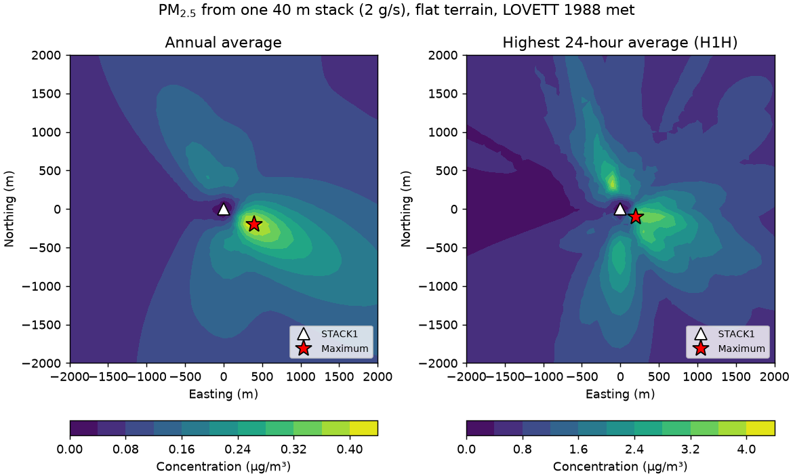

# PyAERMOD Quick Start Guide

## Installation

```bash
pip install pyaermod                 # the library: numpy and pandas
pip install "pyaermod[all]"          # with plotting, GIS export and the GUI
```

Keep the quotes in zsh, the default shell on macOS. Other ways to install,
and what to do when an install fails, are in the
[Install](install.md) page. AERMOD itself is a separate program from
[EPA SCRAM](https://www.epa.gov/scram).

## 5-Minute Example

Create a complete AERMOD input file in just a few lines:

```python
from pyaermod import (
    AERMODProject,
    ControlPathway,
    SourcePathway,
    PointSource,
    ReceptorPathway,
    CartesianGrid,
    MeteorologyPathway,
    OutputPathway,
    PollutantType,
)

# 1. Define the control parameters
control = ControlPathway(
    title_one="My First AERMOD Run",
    pollutant_id=PollutantType.PM25,
    averaging_periods=["ANNUAL", "24"],
    terrain_type="FLAT",
)

# 2. Add your emission source(s)
sources = SourcePathway()
sources.add_source(PointSource(
    source_id="STACK1",
    x_coord=500.0,      # meters (UTM)
    y_coord=500.0,      # meters (UTM)
    base_elevation=10.0,
    stack_height=50.0,   # meters
    stack_temp=400.0,    # Kelvin
    exit_velocity=15.0,  # m/s
    stack_diameter=2.0,  # meters
    emission_rate=1.5,   # g/s
))

# 3. Define receptor grid
receptors = ReceptorPathway()
receptors.add_cartesian_grid(
    CartesianGrid.from_bounds(
        x_min=0, x_max=2000,
        y_min=0, y_max=2000,
        spacing=100,  # 100m grid spacing
    )
)

# 4. Specify meteorology files
meteorology = MeteorologyPathway(
    surface_file="met_data.sfc",
    profile_file="met_data.pfl",
)

# 5. Configure output
output = OutputPathway(
    receptor_table=True,
    max_table=True,
    summary_file="results.sum",
    period_plot_files="conc",  # one PLOTFILE per period: the value at every receptor
)

# 6. Create project and write input file
project = AERMODProject(
    control=control,
    sources=sources,
    receptors=receptors,
    meteorology=meteorology,
    output=output,
)

project.write("my_first_run.inp")
```

That's it! You now have a valid AERMOD input file.

## Running AERMOD from Python

<!-- docs-example: skip (runs AERMOD) -->
```python
from pyaermod.runner import run_aermod

result = run_aermod("my_first_run.inp")
print(f"Success: {result.success}")
print(f"Runtime: {result.runtime_seconds:.1f}s")
print(f"Output: {result.output_file}")
```

!!! note
    You need the AERMOD executable installed separately. Download it from
    [EPA SCRAM](https://www.epa.gov/scram).

## Parsing Output

<!-- docs-example: skip (reads the output of that run) -->
```python
from pyaermod.output_parser import parse_aermod_output

results = parse_aermod_output(result.output_file)
print(results.summary())
df = results.get_concentrations("ANNUAL")   # the .out summary table's rows
print(f"Max concentration: {df['concentration'].max():.4g}")
```

`get_concentrations` returns the rows of AERMOD's summary tables, the
highest ten or so receptors, not the whole grid. The value at every
receptor is in the PLOTFILEs that `period_plot_files` asked for:

<!-- docs-example: skip (reads a plot file of that run) -->
```python
from pyaermod.aermod_outputs import read_plotfile

plot_names = output.period_plot_file_names(control.averaging_periods)
grid = read_plotfile(plot_names["ANNUAL"]).to_dataframe()   # X, Y, AVERAGE_CONC, ...
```

## Visualization

Contour the grid from the period's PLOTFILE:

<!-- docs-example: skip (maps the output of that run) -->
```python
from pyaermod.visualization import AERMODVisualizer

viz = AERMODVisualizer(results)
fig = viz.plot_contours(averaging_period="ANNUAL", plotfile=plot_names["ANNUAL"])
```

Without `plotfile=`, `plot_contours` can only contour the summary
table's few rows, and warns that it is doing so.



The figure comes from [job 1](use-cases.md#1-single-stack-flat-terrain-annual-and-24-hour-pm25),
a complete version of this example run against AERMOD.

## Common Patterns

### Multiple Sources

```python
from pyaermod import SourcePathway, PointSource

sources = SourcePathway()

stack_data = [
    (100.0, 200.0, 1.0),
    (300.0, 400.0, 2.5),
    (500.0, 600.0, 0.8),
]

for i, (x, y, rate) in enumerate(stack_data):
    sources.add_source(PointSource(
        source_id=f"STACK{i + 1}",
        x_coord=x,
        y_coord=y,
        stack_height=50.0,
        stack_temp=400.0,
        exit_velocity=15.0,
        stack_diameter=2.0,
        emission_rate=rate,
    ))
```

### Polar Grid Around Facility

```python
from pyaermod import PolarGrid, ReceptorPathway

receptors = ReceptorPathway()
receptors.add_polar_grid(PolarGrid(
    x_origin=500.0,
    y_origin=500.0,
    dist_init=100.0,      # start 100m from origin
    dist_num=20,          # 20 distance rings
    dist_delta=100.0,     # 100m spacing
    dir_init=0.0,         # start at north
    dir_num=36,           # 36 directions (every 10 degrees)
    dir_delta=10.0,
))
```

### Building Downwash

```python
from pyaermod import PointSource

stack = PointSource(
    source_id="STACK1",
    x_coord=0.0,
    y_coord=0.0,
    stack_height=30.0,
    stack_temp=400.0,
    exit_velocity=15.0,
    stack_diameter=2.0,
    emission_rate=1.5,
    building_height=25.0,
    building_width=40.0,
    building_length=60.0,
    building_x_offset=0.0,
    building_y_offset=20.0,
)
```

Building downwash (PRIME) is also supported on `AreaSource` and `VolumeSource`
with the same five fields. For direction-dependent building downwash, use the
[BPIP module](api/bpip.md).

### Background Concentrations

Add ambient background levels to account for existing pollution:

```python
from pyaermod import (
    SourcePathway, BackgroundConcentration, BackgroundSector,
)

sources = SourcePathway()
# ... add sources ...

# Uniform background — one value applied to every hour
sources.background = BackgroundConcentration(uniform_value=12.0)  # ug/m3

# Or varying in time: a flag of EMISFACT's table and its values
# (SEASON: winter, spring, summer, fall; MONTH takes 12, HROFDY 24)
sources.background = BackgroundConcentration(
    period_values={"SEASON": [14.0, 11.0, 9.0, 12.0]},
)

# Or sector-dependent: starting directions, then each sector's values
sources.background = BackgroundConcentration(
    sectors=[
        BackgroundSector(sector_id=1, start_direction=0.0),
        BackgroundSector(sector_id=2, start_direction=90.0),
    ],
    sector_values={(1, "ANNUAL"): 12.0,
                   (2, "SEASON"): [9.0, 8.0, 7.0, 8.0]},
)
```

### Source Groups

Define custom source groups for separate impact analysis:

```python
from pyaermod import SourcePathway, SourceGroupDefinition

sources = SourcePathway()
# ... add sources STACK1, STACK2, STACK3 ...

sources.group_definitions = [
    SourceGroupDefinition(
        group_name="BOILERS",
        member_source_ids=["STACK1", "STACK2"],
        description="Boiler stacks",
    ),
    SourceGroupDefinition(
        group_name="PROCESS",
        member_source_ids=["STACK3"],
        description="Process vents",
    ),
]
```

A source can also name its groups itself, `source_groups=["BOILERS"]`.
Those cards are written with the definitions above, after every source
(AERMOD stops with `SO E140` on a group card among the source cards).
Naming `ALL` adds nothing, since every source is in it.

### POSTFILE Parsing

<!-- docs-example: skip (reads a POSTFILE of a run) -->
```python
from pyaermod.postfile import read_postfile

# Auto-detects text (PLOT) or binary (UNFORM) format
result = read_postfile("postfile.pst")
print(f"Max concentration: {result.max_concentration:.4g}")
print(f"Location: {result.max_location}")

# Step through timesteps
for date in result.data["date"].unique():
    ts = result.get_timestep(date)
    print(f"{date}: max={ts['concentration'].max():.4g}")
```

## Validation

`project.write()` checks the project against AERMOD's rules first and
refuses one AERMOD would stop on. To see the findings yourself:

```python
from pyaermod.validator import Validator

result = Validator.validate(project)
print(result.is_valid)
for error in result.errors:      # errors and warnings, each naming its field
    print(error)
```

## Reading an existing deck

`read_aermod_input` reads an AERMOD `.inp` deck into the same objects,
so an existing run can be changed and written again. A line pyaermod
does not model (EMISFACT, INCLUDED, SITEDATA, EVALCART, DISCPOLR, a
malformed line of a known keyword) is kept verbatim in
`project.unparsed_lines`
(pathway, keyword, fields, line number), reported with one `logging` warning
per pathway and keyword, and written back into its pathway by
`project.write()` / `project.to_aermod_input()`. Pass
`preserve_unparsed=False` to write only what the model represents.

<!-- docs-example: skip (reads a deck of your own) -->
```python
import logging
from pyaermod.input_reader import read_aermod_input

logging.basicConfig(level=logging.WARNING)
project = read_aermod_input("epa_deck.inp")
# WARNING:pyaermod.input_reader:SO EMISFACT: 33 lines not modelled by pyaermod; ...
for line in project.unparsed_lines:
    print(line.pathway, line.keyword, line.fields)
project.write("epa_deck_copy.inp")   # the EMISFACT lines are in the SO pathway
```

## More recipes

Each of these is a complete script, run against AERMOD, with the figure
it drew, in [Ten Common AERMOD Jobs](use-cases.md):

- dry and wet deposition with particle size categories
  ([job 9](use-cases.md#9-particle-dry-and-wet-deposition); size
  distributions in [Particle Size Distributions](psd.md));
- NO2 chemistry with OLM, PVMRM, ARM2 or GRSM
  ([job 6](use-cases.md#6-1-hour-no2-with-tier-2-and-tier-3-chemistry));
- the 1-hour SO2 and NO2 and 24-hour PM2.5 design values
  ([job 7](use-cases.md#7-naaqs-compliance-the-1-hour-so2-design-value));
- terrain from AERMAP
  ([job 8](use-cases.md#8-elevated-and-complex-terrain-with-aermap)).

Hourly emission files (`HOUREMIS`) are in
[`hourly_emissions`](api/hourly_emissions.md), EVENT runs in
[`pathways`](api/pathways.md) (`EventPathway`), runs of many cases in
[Ensembles](ensemble.md), and POSTFILEs with several output types in
[`postfile`](api/postfile.md). Every AERMOD keyword pyaermod reads and
writes is listed in the [keyword audit](keyword-audit-v26135.md), and
the evidence that pyaermod reproduces EPA's results is in
[Validation](validation.md).

## Next Steps

- Work through [Ten Common AERMOD Jobs](use-cases.md): complete scripts,
  run against AERMOD, for the analyses AERMOD is most often used for
- Try the [GUI User Guide](gui-guide.md) for a no-code modeling experience
- Browse the [API Reference](api/index.md) for detailed module documentation
- Check the [examples/](https://github.com/atmmod/pyaermod/tree/main/examples)
  directory for runnable scripts and Jupyter notebooks

For AERMOD itself, see EPA's documentation on
[SCRAM](https://www.epa.gov/scram).
