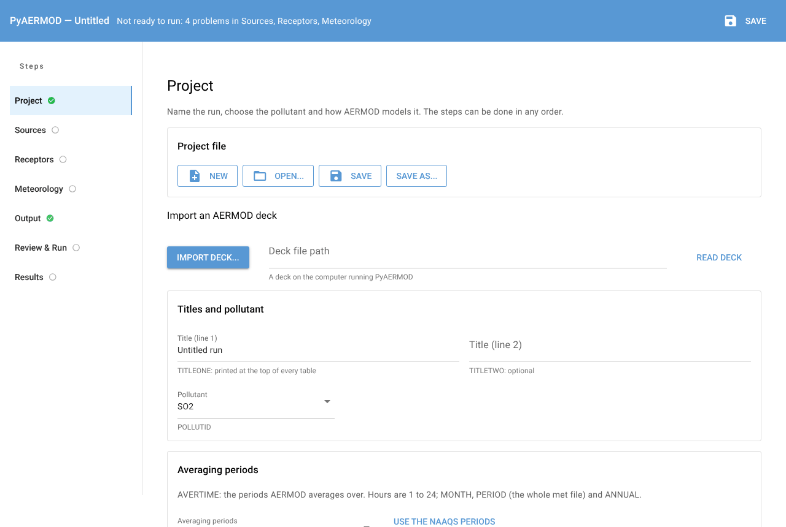

# 3. Setting Up pyaermod

> **Want to see AERMOD run before you install anything?** Go to
> **https://atmmod.github.io/pyaermod/browser/** and click **Open the
> notebooks**. In a few minutes, inside your web browser, the notebooks
> build a model of one smokestack, run AERMOD and draw a map of the
> concentrations. Nothing is installed on your computer. The notebooks use
> short Python code rather than the GUI, so they do not replace the
> tutorials below. The AERMOD they run is an
> unofficial build of EPA's code, fine for learning but not for regulatory
> work.

## 3.1 Install

Open a terminal (Command Prompt on Windows, Terminal on Mac/Linux) and run:

```bash
pip install "pyaermod[gui]"    # keep the quotes: zsh, the macOS shell, needs them
pyaermod info                  # lists the pyaermod version and what can run here
```

[Install](../../install.md) has the other ways to install and what to do
when an install fails.

## 3.2 Install the AERMOD and AERMET Executables

pyaermod writes input files, launches the model and plots results, but it does
**not** include AERMOD or AERMET. Those are separate Fortran programs from the
U.S. Environmental Protection Agency (EPA).

**Which executables do you need?**

| Executable | What it does | Which tutorials need it |
|---|---|---|
| `aermod` | Runs the dispersion model | Tutorial 3 (running AERMOD) |
| `aermet` | Preprocesses meteorological data | Tutorial 5 (AERMET processing) |
| `aermap` | Preprocesses terrain elevations | Optional (terrain analysis) |

Tutorials 1–2 only generate input files, so you can **skip this step
initially** and come back when you're ready for Tutorial 3.

If you cannot install programs on your computer (a shared lab computer, for
example), the [browser notebooks](https://atmmod.github.io/pyaermod/lite/lab/index.html?path=01_run_aermod_in_your_browser.ipynb) run AERMOD without these executables.

### Option A: Compile from source (macOS and Linux)

pyaermod's build script downloads EPA's public-domain Fortran source and
compiles **all three executables** (AERMOD, AERMAP and AERMET). EPA does not
publish macOS or Linux executables, and pyaermod releases do not include any.

**Prerequisites:** You need `gfortran` (the GNU Fortran compiler).

On macOS, install it with [Homebrew](https://brew.sh):

```bash
brew install gcc
```

On Ubuntu/Debian Linux:

```bash
sudo apt-get install gfortran
```

**Build steps:**

```bash
git clone https://github.com/atmmod/pyaermod.git
cd pyaermod
./scripts/build_aermod.sh all
```

This creates executables in the `bin/` directory. Move them to your PATH:

```bash
mkdir -p ~/bin
cp bin/aermod bin/aermap ~/bin/
```

and AERMET the same way:

```bash
cp bin/aermet ~/bin/
```

Then add `~/bin` to your PATH so pyaermod can find them. Add this line to
your `~/.zshrc` (or `~/.bashrc` on Linux):

```bash
export PATH="$HOME/bin:$PATH"
```

Then **restart your terminal** (close and reopen it), or run
`source ~/.zshrc` in your current session, and check:

```bash
which aermod
aermod
```

`which` should print the path to `aermod`. Running `aermod` alone prints a
version header and then stops with an error about a missing input file:
**that is normal** and means it is installed.

To build straight into another directory instead of `bin/`, set `BIN_DIR`
(a relative path is taken from the directory you run the script in):

```bash
BIN_DIR=~/bin ./scripts/build_aermod.sh all
```

The script prints a build record for each executable (checksum, compiler,
flags); `scripts/build_aermod.sh` has the other options.

### Option B: Windows

The EPA provides official Windows executables:

1. Go to the [EPA SCRAM website](https://www.epa.gov/scram/air-quality-dispersion-modeling-preferred-and-recommended-models).
2. Download the **AERMOD Modeling System** zip file.
3. Extract the zip. Inside you'll find `aermod.exe`, `aermet.exe`, and
   `aermap.exe`.
4. Place them in a folder (e.g., `C:\AERMOD\`) and add that folder to your
   system PATH:
   - Search for **"Environment Variables"** in the Start menu.
   - Under **System variables**, find `Path`, click **Edit**.
   - Click **New** and add `C:\AERMOD\` (or wherever you put the files).
   - Click **OK** to save.
5. Open a **new** Command Prompt and verify:

```
aermod
```

> **The GUI finds the `aermod` executable on your PATH.** It has no field for
> the path: if "No 'aermod' binary on PATH" appears on the Review & Run step,
> put `aermod` on your PATH and start the GUI again.

## 3.3 Launch the GUI

```bash
pyaermod-app
```

Your web browser will open automatically to `http://127.0.0.1:8080`. You'll see
the pyaermod interface with a list of steps on the left and the **Project**
step in the main area. (If port 8080 is already in use on your computer, run
`pyaermod-app --port 8081` instead.)

> **Tip:** The GUI runs as a local web app. It never sends your data to the
> internet — everything stays on your computer.

## 3.4 GUI Layout

The [GUI user guide](../../gui-guide.md#layout) describes the layout: a
header with the project's name and a readiness summary, a step list with a
badge per step, and the current step.

The 7 steps, in workflow order:

1. **Project** — open and save project files; titles, pollutant, averaging
   periods, terrain
2. **Sources** — add and edit emission sources
3. **Receptors** — define where concentrations are calculated
4. **Meteorology** — point to weather data files
5. **Output** — choose the files and tables AERMOD writes
6. **Review & Run** — readiness checklist, input-file preview, and the run
7. **Results** — maxima, concentration map, NAAQS comparison, downloads

You can visit the steps in any order. The GUI calls an AERMOD input file a
**deck**, the modelers' word for it.

All coordinates in the GUI are AERMOD's model coordinates: easting and
northing in UTM (Universal Transverse Mercator) meters. There is no map to
click and no latitude/longitude setting.


