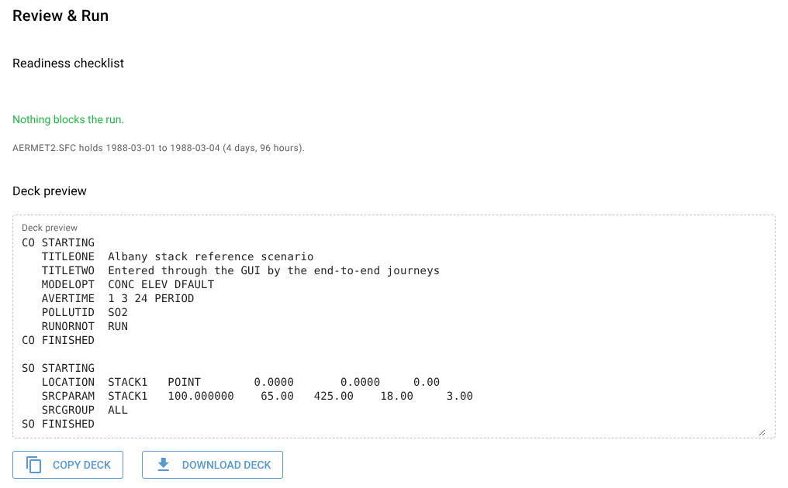
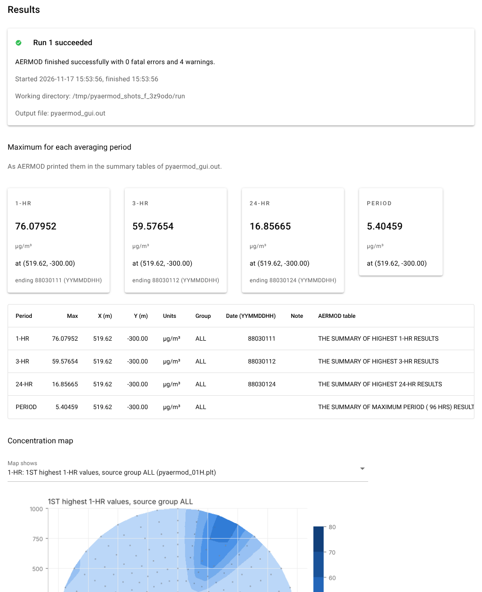
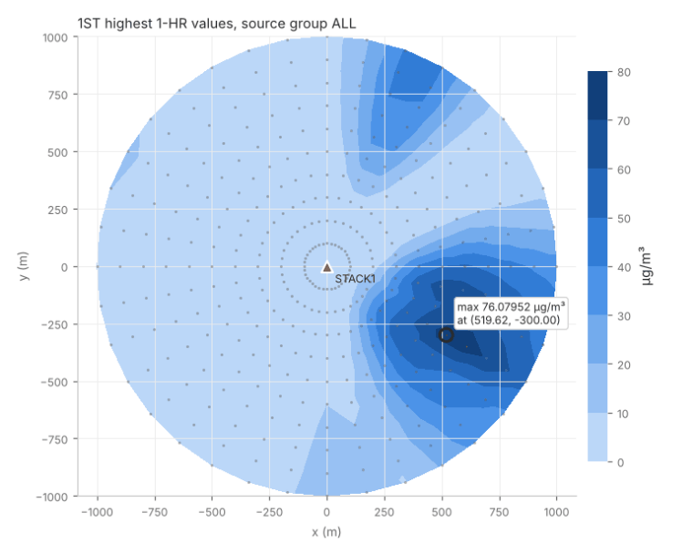

# 6. Tutorial 3 — Running AERMOD and Reading Results

**Goal:** Run AERMOD with real meteorological data and interpret the results
using the GUI's Results step.

**Time:** 30--45 minutes

**Prerequisites:**
- The `aermod` executable must be installed and on your PATH. If you haven't
  done this yet, go back to **[Section 3.2](setup.md#32-install-the-aermod-and-aermet-executables)**
  and follow the instructions for your operating system.
- Meteorological data files (`.sfc` and `.pfl`). Your instructor may provide
  these, or you can process your own with AERMET (Tutorial 5).

> **If you don't have met data yet:** Your instructor should provide a pair of
> `.sfc` and `.pfl` files for your region. These are typically generated from
> NOAA weather station data using the AERMET preprocessor. Ask your instructor
> which files to use and where to find them.
>
> **If AERMOD is not installed:** Run `which aermod` (Mac/Linux) or
> `where aermod` (Windows) in a terminal. If nothing is printed, go back to
> [Section 3.2](setup.md#32-install-the-aermod-and-aermet-executables) to install it.

## Step 1: Verify AERMOD Is Installed

Open a terminal and type:

```bash
aermod
```

If AERMOD is installed, you'll see an error about missing input files (that's
OK — it just confirms the executable is found). If you get "command not found,"
you need to install AERMOD or add it to your PATH.

## Step 2: Set Up the Model

Open one of your Tutorial 2 project files (**Project** step, **Open...**), or
start a new project (**New**):

**Project:**
- Title (line 1): `Tutorial 3 - Full AERMOD Run`
- Pollutant: `PM25`
- Averaging periods: `24` and `ANNUAL`
- Terrain: `Flat (FLAT)`, with **Regulatory default options (DFAULT)** unticked

**Source:**
- A single point source with realistic parameters (see Tutorial 1)

**Receptors:**
- Cartesian grid: 4 km x 4 km, 100 m spacing (41 x 41 = 1,681 receptors)

**Meteorology:**
- Click **Meteorology** in the step list.
- Under **Met files**, enter the full paths of your `.sfc` and `.pfl` files
  in **Surface file** and **Profile file**. Give the whole path (for example
  `/Users/you/met/site.sfc` or `C:\met\site.sfc`): AERMOD does not expand
  `~`, and the GUI tells you under the field when a path is not a file on
  your computer. There is no upload button; the files stay where they are.
- Below the files, the step says what the surface file holds: the period it
  covers, the station IDs in its header and the first year of its data.
- Under **Stations**, set **Surface station ID**, **Upper air station ID**
  and **Data start year** to those values. AERMOD checks them against the
  files.

> **ANNUAL needs a full year.** If your met files cover less than a year,
> the GUI warns that AERMOD would stop the run. Replace `ANNUAL` with
> `PERIOD` on the Project step, which averages over whatever the files hold.

## Step 3: Review and Run

1. Click **Review & Run** in the step list.
2. Read the **Readiness checklist**. The GUI checks the project every time
   you change it and lists here everything that would stop the run, each
   item with a link to the step that fixes it (common issues: missing met
   file paths, no sources defined, no receptors defined). When the list is
   empty the step says "Nothing blocks the run." Warnings that do not stop
   the run are listed under **Before you run**.
3. Set the **Working directory** — this is where AERMOD will write its
   output. If you leave it blank, each run gets a new temporary folder.
4. If the checklist says "No 'aermod' binary on PATH", AERMOD is not
   installed where the GUI can find it: go back to Step 1.
5. Click **Run AERMOD**.

A progress bar follows AERMOD through the days of your met data, next to
the elapsed time and a **Cancel** button. Depending on your grid size and the
number of hours of met data, this may take anywhere from 10 seconds to a few
minutes.

When it finishes, the status line reads either:
- "Succeeded in *N* s. See the Results step.", or
- "Failed: *reason*", above a table of AERMOD's messages and a **Run log**.
  Read the messages — the most common issue is AERMOD not finding the
  meteorological files.



## Step 4: Explore the Results

Click **Results** in the step list. The step shows the run in several
sections, from top to bottom:

### Maximum for Each Averaging Period

- One card per averaging period with the **maximum concentration**: the
  highest value at any receptor, its units, the receptor where it occurred
  and the date it ended. This is the starting point for a comparison with
  the NAAQS.

### Concentration Map

- Filled contours of concentration (isopleths — areas between lines of equal
  concentration), with your source and the highest value marked.
- **Map shows** selects the averaging period (e.g., `ANNUAL`).
- Notice the **plume shape**: concentrations are highest downwind of the source
  and decrease with distance. The elongated pattern reflects the prevailing
  wind direction in your met data.
- The pattern around the source shows how concentrations decrease
  with distance — the **concentration gradient**.
- The map is a picture: it does not zoom or pan. The numbers behind it are in
  the tables and in the plot files under **Downloads**.

### Comparison with the NAAQS and Summary Tables

This is where you do compliance analysis:

- **Comparison with the NAAQS**: one row for each standard of your
  pollutant, with the standard's level, this run's value, where it occurred,
  what was compared and the result.
- **Summary tables**: the ten highest values of each averaging period, with
  their dates and receptor coordinates. Where are the worst-case locations?
- **Exceedance analysis**: the GUI does not count the receptors above a
  standard. To count them, download the plot file of that averaging period
  from **Downloads** (a text file with one row per receptor: X, Y and the
  highest concentration there) and open it in a spreadsheet.

**Common NAAQS values for reference:**

| Pollutant | Period | Standard (ug/m3) |
|---|---|---|
| PM2.5 | Annual | 9.0 |
| PM2.5 | 24-hour | 35 |
| PM10 | 24-hour | 150 |
| SO2 | 1-hour | 196 |
| NO2 | 1-hour | 188 |
| CO | 8-hour | 10,000 |

### Downloads and POSTFILEs (Advanced)

**Downloads** lists the deck, AERMOD's `.out` file, the plot files and the
POSTFILEs of the run. A POSTFILE holds the concentration at every receptor
for every averaging interval; the GUI writes one per averaging period
unless you untick **POSTFILE for every averaging period** on the **Output**
step. The GUI does not animate them. From Python,
`pyaermod.postfile.read_postfile` reads one into a table. This is optional
for beginners.





## Step 5: Interpret What You See

Ask yourself these questions:

1. **Where is the maximum concentration?** It should be downwind of the source,
   at a distance that depends on stack height and meteorology. For a 50 m
   stack, the peak is typically 500--2000 m downwind.

2. **What direction does the plume extend?** This reflects the prevailing wind
   direction in your met data. If the wind usually blows from west to east,
   the highest concentrations will be east of the source.

3. **Does the maximum exceed the NAAQS?** Read the result in the
   **Comparison with the NAAQS** table. If the standard is exceeded, the
   facility would need additional controls (taller stack, emission
   reduction, scrubbers, etc.).

4. **How quickly do concentrations drop with distance?** Look at the
   concentration map — concentrations typically drop to 10% of the maximum within 1--2 km
   for elevated point sources.

## Checkpoint

At this point you should understand:

- [x] How to run AERMOD from the GUI
- [x] How to read the concentration map and identify the plume direction
- [x] How to find the maximum concentration and where it occurs
- [x] How to check whether a facility complies with air quality standards
- [x] That wind direction and stack height are the dominant factors in where
  the plume goes and how concentrated it is
