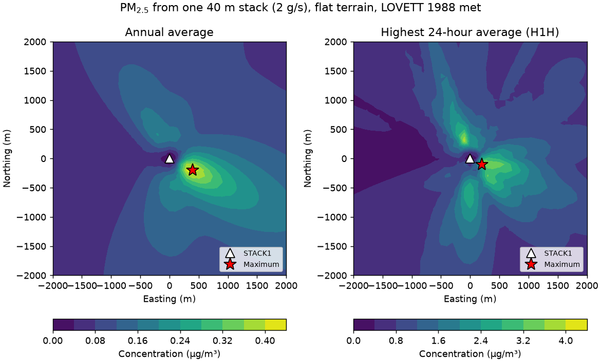
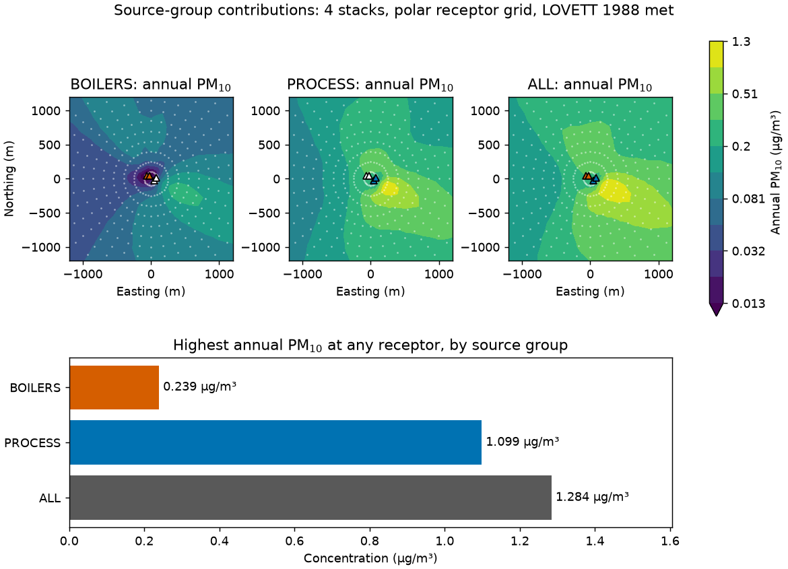
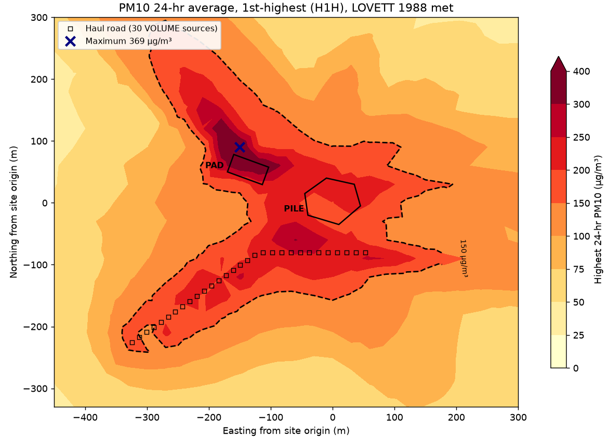
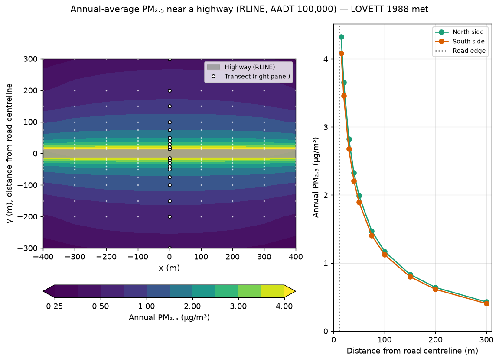
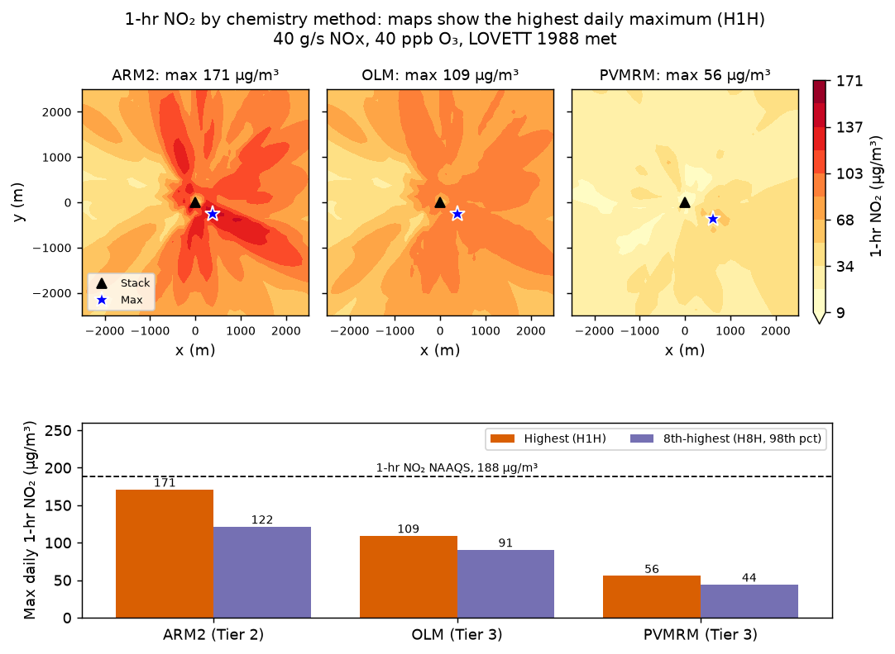
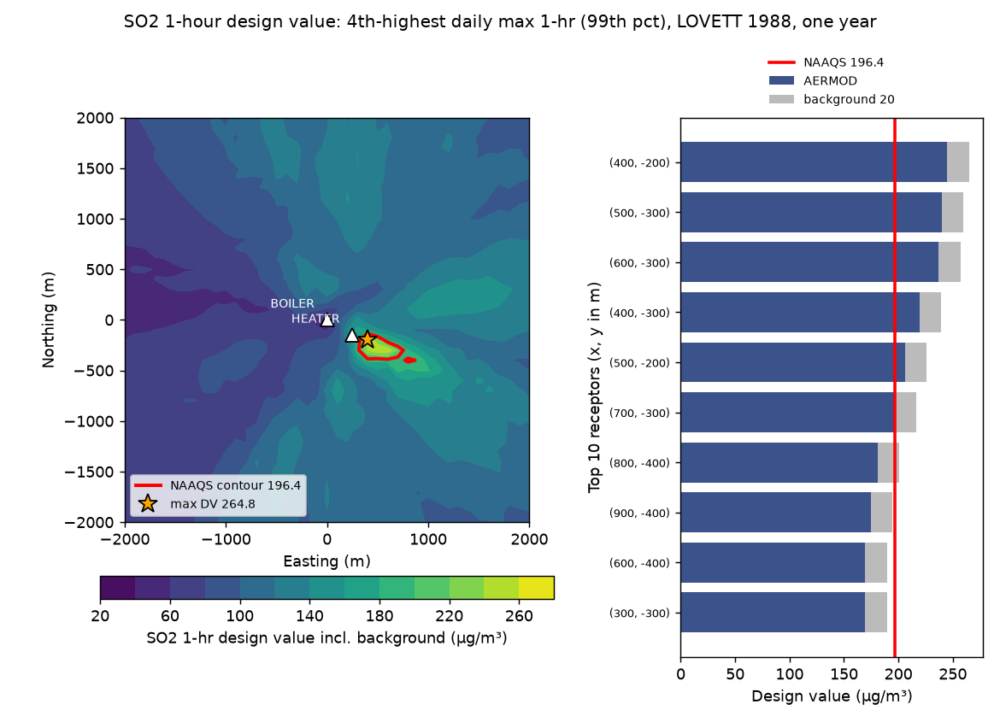
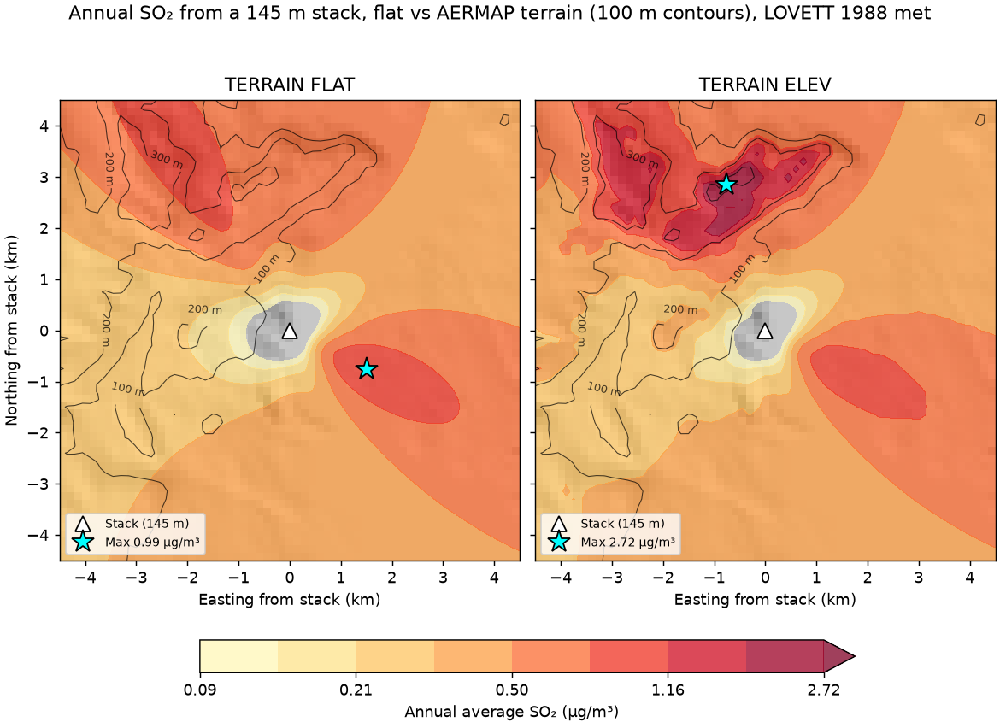
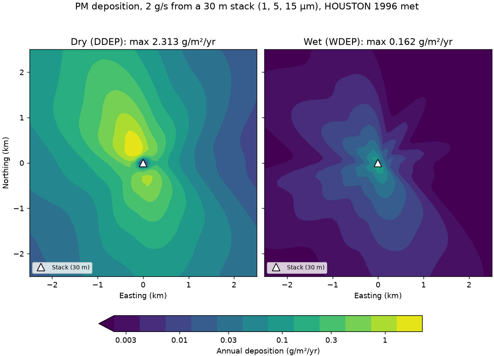
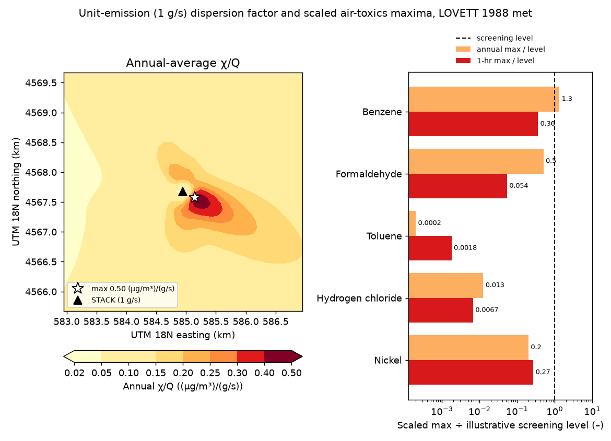

# Ten Common AERMOD Jobs

Ten worked examples of the jobs AERMOD is most often run for, each done
end to end with pyaermod: build the project, validate it, write the
deck, run AERMOD, parse the results and draw a figure. Every code block
on this page is a complete script from
[`examples/use_cases/`](https://github.com/atmmod/pyaermod/tree/main/examples/use_cases),
included here verbatim, and every figure is what that script drew when
it was run against AERMOD 26135.

| # | Job | Main pyaermod pieces |
|---|-----|----------------------|
| 1 | [Single stack, flat terrain: annual and 24-hour PM2.5](#1-single-stack-flat-terrain-annual-and-24-hour-pm25) | `PointSource`, `CartesianGrid`, `period_plot_files`, `read_plotfile` |
| 2 | [Facility with several stacks: source groups and a polar grid](#2-facility-with-several-stacks-source-groups-and-a-polar-grid) | `SourceGroupDefinition`, `PolarGrid`, `plot_file_groups` |
| 3 | [Building downwash with BPIP-PRIME](#3-building-downwash-with-bpip-prime) | `Building`, `set_building_from_bpip`, `gep_from_building` |
| 4 | [Fugitive emissions: area, polygon and volume sources](#4-fugitive-emissions-area-polygon-and-volume-sources) | `AreaPolySource`, `AreaSource`, `VolumeSource`, `footprints` |
| 5 | [Near-road roadway modeling with RLINE](#5-near-road-roadway-modeling-with-rline) | `RLineSource`, `CartesianGrid` `x_points`/`y_points` |
| 6 | [1-hour NO2 with Tier 2 and Tier 3 chemistry](#6-1-hour-no2-with-tier-2-and-tier-3-chemistry) | `ChemistryOptions` (ARM2/OLM/PVMRM), `OzoneData` |
| 7 | [NAAQS compliance: the 1-hour SO2 design value](#7-naaqs-compliance-the-1-hour-so2-design-value) | `naaqs_output_pathway`, `read_maxdaily`, `naaqs_compliance_report` |
| 8 | [Elevated and complex terrain with AERMAP](#8-elevated-and-complex-terrain-with-aermap) | `DEMDownloader`, `TerrainProcessor`, AERMAP |
| 9 | [Particle dry and wet deposition](#9-particle-dry-and-wet-deposition) | `ParticleDepositionParams`, `calculate_dry/wet_deposition` |
| 10 | [Air-toxics screening with a unit emission rate (χ/Q) and GIS export](#10-air-toxics-screening-with-a-unit-emission-rate-χq-and-gis-export) | `latlon_to_utm`, GeoTIFF/GeoJSON export, `to_kmz` |

## Before you start

**1. Install pyaermod with its plotting and GIS extras.**

```bash
pip install "pyaermod[all]"
```

**2. Put AERMOD on your `PATH`.** pyaermod writes and reads AERMOD's
files; it does not ship the model. Download the executable (or the
source) from [EPA SCRAM](https://www.epa.gov/scram/air-quality-dispersion-modeling-preferred-and-recommended-models#aermod),
or build it with `scripts/build_aermod.sh` from a pyaermod checkout.
Check it is found:

```bash
python -c "from pyaermod.runner import AERMODRunner; print(AERMODRunner().executable)"
```

Use case 8 also needs AERMAP on `PATH` (same EPA page, or
`scripts/build_aermod.sh`), and downloads its terrain from USGS.

**3. Get the meteorology.** The scripts use one year (1988) of
AERMET-processed surface and profile data from the Lovett site in New
York's Hudson Valley, `LOVETT.SFC` and `LOVETT.PFL`, which EPA
distributes with the AERMOD test cases. Pull just those files out of
the archive:

```bash
curl -LO https://gaftp.epa.gov/Air/aqmg/SCRAM/models/preferred/aermod/aermod_test_cases.zip
```

```bash
unzip -j -o aermod_test_cases.zip "*/meteorology/LOVETT.*" "*/meteorology/HOUSTON_ADJU.*" -d met
```

Use case 9 uses `HOUSTON_ADJU.SFC`/`.PFL` (Houston, 1996) instead,
because wet deposition needs hourly precipitation and every
precipitation value in `LOVETT.SFC` is missing.

For your own site, replace them with the `.SFC`/`.PFL` pair AERMET made
for it (see [AERMET Tuning](aermet-tuning-guide.md)).

**4. Run a script.** Each script reads the met directory from
`AERMOD_MET_DIR` (default `./met`) and writes its deck, AERMOD's
output and its figure under `USE_CASE_OUT` (default `./out`):

```bash
python examples/use_cases/01_point_source.py
```

The scripts are written to be copied: the inputs a user changes sit at
the top, and nothing depends on the others. Emission rates, stack
parameters and coordinates are illustrative, not from any real facility.

!!! warning "One year of met is a demonstration, not a permit analysis"
    Regulatory analyses use five years of representative National
    Weather Service data (or at least one year of site-specific data)
    and the averaging-period ranks the NAAQS sets. These examples use
    one year so each runs in under a minute or two.

## 1. Single stack, flat terrain: annual and 24-hour PM2.5

**When you need it:** You are permitting or screening a single new or modified stack. You need its annual and 24-hour PM2.5 impacts on a receptor grid to compare with the NAAQS or a significant impact level.

**What it shows:** Each AERMOD pathway built from pyaermod objects: [`ControlPathway`](api/pathways.md), [`PointSource`](api/sources.md), [`CartesianGrid`](api/receptors.md), [`MeteorologyPathway`](api/pathways.md) and [`OutputPathway`](api/pathways.md), with `period_plot_files` writing one PLOTFILE per averaging period. Then [`Validator`](api/validator.md), [`run_aermod`](api/runner.md), the 8th-highest 24-hour summary table read with [`parse_aermod_output`](api/output_parser.md), and the per-receptor maps drawn from [`read_plotfile`](api/aermod_outputs.md).

```python
--8<-- "examples/use_cases/01_point_source.py"
```

**Result** (AERMOD 26135, LOVETT 1988 met):



The annual average peaks at 0.431 µg/m³, 450 m east-southeast of the stack at (400, -200) m, and falls off along the prevailing downwind direction. The highest 24-hour average (H1H) is 4.177 µg/m³ at (200, -100) m. The 24-hour map is patchier because each receptor's highest day comes from a different wind direction. The 8th-highest 24-hour value, the rank the PM2.5 NAAQS uses, is 2.327 µg/m³ at (400, -200) m.

!!! tip "Adapting it"
    - Change the `PointSource` stack parameters and `emission_rate` (g/s), and size the `CartesianGrid` so the maximum is well inside it. Here it is within 500 m of a 40 m stack.
    - Under the regulatory `DFAULT` option, AERMOD ignores `MODELOPT FLAT` and runs with elevated terrain, logging warning W206. That is why this example sets `regulatory_default=False`. For a regulatory run, keep `DFAULT` and give receptors real elevations from AERMAP. On flat ground with zero elevations both give the same numbers here.
    - `OutputPathway` plot files always write the highest (`FIRST`) short-term value. Read the 8th-highest from the `.out` summary tables (`results.summaries`), as the script does, or add `max_daily_files` (MAXDAILY) for NAAQS work. The design value needs five years of met: the 24-hour H8H and the annual average, each averaged over those years.
    - Put your own AERMET `.SFC`/`.PFL` in `MET_DIR`. Then set `surface_station_id`, `upper_air_station_id` and `data_start_year` from the surface file's header, and `profile_base_elevation` to the station's base elevation (m MSL).

---

## 2. Facility with several stacks: source groups and a polar grid

**When you need it:** A facility has several emission points, and you need each part's share of the total impact. Examples are a boiler house against process vents, or existing units against a proposed modification. That share tells you which units to control, or which ones a permit limit should cover.

**What it shows:** Several [`PointSource`](api/sources.md) objects, grouped with [`SourceGroupDefinition`](api/sources.md) (AERMOD's `SRCGROUP`; `ALL` is added for you). A [`PolarGrid`](api/receptors.md) is centred on the facility. `OutputPathway.plot_file_groups` writes one PLOTFILE per group, and each is read with [`read_plotfile`](api/aermod_outputs.md).

```python
--8<-- "examples/use_cases/02_multi_source_groups.py"
```

**Result** (AERMOD 26135, LOVETT 1988 met):



The two short process stacks (18 m and 25 m) dominate the impact even though they emit less than the two 45 m boiler stacks (1.3 g/s against 2.4 g/s). The PROCESS group peaks at 1.099 µg/m³ at (217, -125) m. BOILERS peaks at only 0.239 µg/m³, farther out at (376, -137) m. ALL peaks at 1.284 µg/m³ at the PROCESS maximum. There BOILERS adds 0.186 µg/m³, and the two groups sum to ALL (to rounding). Group maxima generally fall at different receptors, so they do not add up to the ALL maximum.

!!! tip "Adapting it"
    - Edit the `STACKS` table and the `GROUPS` mapping. Group IDs are at most 8 characters, and a source may belong to several groups. Don't define `ALL` yourself: pyaermod writes `SRCGROUP ALL`.
    - Set the polar grid's `dist_init`/`dist_delta`/`dist_num` so the innermost ring sits at or just beyond the fence line. Polar grids are coarse far out (the ring at 1 km has receptors 175 m apart), so add a Cartesian or discrete grid where the maximum lands.
    - `plot_file_groups` takes `(averaging period, group, filename)`. A short-term period writes the highest (`FIRST`) value per receptor.
    - To get each source's contribution to one specific modelled event, rather than to the long-term average, use an EVENT run (`ControlPathway.eventfil`).

---

## 3. Building downwash with BPIP-PRIME

**When you need it:** A stack is shorter than its Good Engineering Practice (GEP) height, for example a 30 m stack next to a 22 m building. AERMOD must then model the building wake (PRIME). That needs 36 direction-specific building dimensions per source, which EPA's BPIP-PRIME normally computes.

**What it shows:** A [`Building`](api/bpip.md) footprint and [`PointSource.set_building_from_bpip`](api/sources.md), which runs [`BPIPCalculator`](api/bpip.md) and fills `BUILDHGT`, `BUILDWID`, `BUILDLEN`, `XBADJ` and `YBADJ`. [`gep_from_building`](api/prime.md) gives the GEP height. The same deck is run with and without the building data through [`Validator`](api/validator.md) and [`run_aermod`](api/runner.md). The maximum is read with [`parse_aermod_output`](api/output_parser.md) and the maps are drawn from [`read_plotfile`](api/aermod_outputs.md).

```python
--8<-- "examples/use_cases/03_building_downwash.py"
```

**Result** (AERMOD 26135, LOVETT 1988 met):


GEP for this building is 65.0 m, so the 30 m stack is subject to downwash. BPIP gives a projected width of 40 m for winds from east and west and 80 m for winds from north and south. Without building data, the highest 1-hour concentration is 60.04 µg/m³ per g/s, at (0, -20). With BPIP-PRIME it rises to 110.74 µg/m³ per g/s at (-40, 100), almost double. The highest values sit in two lobes north and south of the building, where the wake brings the plume to the ground. The effect is not only local: in every distance band out to 600 m, the downwash run's highest 1-hour value is 1.6 to 3.5 times that of the run without building data.

!!! tip "Adapting it"
    - Replace `corners` (any polygon of three or more vertices, in the same coordinates as the sources) and `height` with your building, and move the stack. `set_building_from_bpip` also works on `AreaSource` and `VolumeSource`.
    - `set_building_from_bpip` takes one building. With several buildings, EPA BPIP picks the controlling building for each direction. [`apply_bpip_to_project`](api/prime.md) instead uses the single nearest building within 5L for each source. Multi-tier buildings are approximated (a warning says so). For a regulatory submittal, check the arrays against EPA BPIP-PRIME.
    - A short-term `PLOTFILE ... FIRST` needs a `RECTABLE` for that period. Without it AERMOD stops with `E203 OUPLOT ... HIVALU`, which pyaermod's validator does not catch. Keep `receptor_table=True`.
    - Under `DFAULT`, AERMOD overrides `MODELOPT FLAT` (warning W206). This example keeps the regulatory default and uses `ELEV` with every elevation at 0 m, which gives the same result on flat ground.

---

## 4. Fugitive emissions: area, polygon and volume sources

**When you need it:** Storage piles, yards and unpaved haul roads at quarries, aggregate plants, landfills and construction sites release PM10 near the ground. A permit or a dust-control plan has to show their 24-hour impacts at the fenceline and beyond.

**What it shows:** Three of AERMOD's non-point source types from [pyaermod's source classes](api/sources.md). The irregular pile is an `AreaPolySource`, a rotated rectangular pad is an `AreaSource`, and the haul road is a string of `VolumeSource`s laid out with EPA's 2012 haul-road recipe. Area-source emission rates are per square metre (g/s/m²); volume rates are g/s. The deck is checked with [`Validator`](api/validator.md) and run with [`run_aermod`](api/runner.md). The H1H and H2H are read from the summary table with [`parse_aermod_output`](api/output_parser.md), and the per-receptor map from [`read_plotfile`](api/aermod_outputs.md). The footprints are drawn with `pyaermod.footprints.source_footprint`, which reproduces the outline AERMOD builds from `LOCATION`/`SRCPARAM`/`AREAVERT`.

```python
--8<-- "examples/use_cases/04_fugitive_sources.py"
```

**Result** (AERMOD 26135, LOVETT 1988 met):



The haul road is split into 30 volume sources, 14 m apart, and the pile covers 4750 m². The highest 24-hour PM10 is 369.0 µg/m³ at (-150, 90), just north of the laydown pad. The highest second-high (H2H) is 327.6 µg/m³ at (-120, 60). The pad emits only 0.02 g/s but releases at 1 m, so on stable, light-wind days it dominates its immediate surroundings. The road's contribution follows its length. The dashed line is 150 µg/m³, the level of the 24-hour PM10 NAAQS. It encloses the whole yard and a 50–100 m band along the road. Ground-level fugitive sources typically give the highest near-field impacts of any source type.

!!! tip "Adapting it"
    - Set `ROAD` to your road's vertices and `WIDTH` to the road width + 6 m. For other truck heights, set the release height to half of 1.7 × the truck height and σz0 to 1.7 × the truck height ÷ 2.15. Divide the road's total g/s evenly among the volumes. Area sources take g/s/m², so divide each total by its footprint area.
    - Area sources are slow. This deck (about 570 receptors, one year) takes about 4 minutes. Receptor count drives the runtime, so use a coarse grid to explore and refine it near the maximum. An `AreaCircSource` is modelled as a 20-sided polygon and was the slowest type in a timing test. Lower `num_vertices` if you use one.
    - For PM10, the NAAQS compares the H6H over five years, or the H2H for one year, with 150 µg/m³. pyaermod's `OutputPathway.plot_file` always writes the `FIRST` rank, so the map shows H1H. Take the H2H from the summary table, as the script does.
    - Under `DFAULT`, AERMOD overrides `MODELOPT FLAT` (warning W206). This example keeps `DFAULT` and uses `ELEV` with all elevations at 0 m. A `PLOTFILE` rank needs a `RECTABLE` at least that deep, or AERMOD stops with E203.

---

## 5. Near-road roadway modeling with RLINE

**When you need it:** You need concentrations within a few hundred metres of a highway. Typical cases are a PM2.5 or CO hot-spot analysis for transportation conformity, a near-road exposure study, or siting a school, monitor or housing next to a road. AERMOD's RLINE source handles this. In AERMOD 26135 it runs under the regulatory `DFAULT` option. RLINEXT, by contrast, still requires `ALPHA` (E198).

**What it shows:** [`RLineSource`](api/sources.md) with its emission rate computed from traffic volume and a per-vehicle emission factor. A non-uniform receptor network packed near the road is built with [`CartesianGrid`](api/receptors.md) `x_points`/`y_points` (`GRIDCART XPNTS/YPNTS`). The project is checked with [`Validator`](api/validator.md) and run with [`run_aermod`](api/runner.md). The annual plot file (`OutputPathway.period_plot_files`) is read back with [`read_plotfile`](api/aermod_outputs.md) for the map and the cross-road profile.

```python
--8<-- "examples/use_cases/05_roadway.py"
```

**Result** (AERMOD 26135, LOVETT 1988 met):



100,000 vehicles/day at 0.010 g/(veh·km) is 1.157e-05 g/(s·m) of road, or 4.823e-07 g/(s·m²) over the 24 m width. That gives a maximum annual PM2.5 increment of 4.323 µg/m³ at 15 m from the centreline (3 m past the road edge). The increment falls to about half by 50 m (1.988 north, 1.892 south), to 1.172 / 1.124 µg/m³ at 100 m and to 0.428 / 0.404 µg/m³ at 300 m. That steep near-road gradient is why receptors are packed close to the road. The north side is only ~5 % higher, so in this met year winds from the south and from the north across this east-west road are nearly balanced. At a site with a dominant cross-road wind, the downwind side is clearly higher.

!!! tip "Adapting it"
    - **Units:** `RLineSource.emission_rate` is per unit *area*, g/(s·m²). AERMOD multiplies it by the road width (`initial_lateral_dimension`, the *full* width, not half). Turn a MOVES rate per vehicle-mile into g/(s·m) of road with the traffic volume, then divide by the width, as the script does. `RLineExtSource` takes g/(s·m) per unit *length* instead.
    - **Run time:** RLINE integrates along the line for every receptor and hour, so run time grows with receptors × road length × hours. This 180-receptor, 1 km, one-year run takes ~6 min. A uniform 20 m grid (1,581 receptors) over a 2 km road would take an estimated 2+ h. Split long corridors into segments and keep receptors where you need them.
    - Endpoint release heights, barriers (`RBARRIER`), depressed roads (`RDEPRESS`) and vegetation (`VBARRIER`) need `RLineExtSource` (RLINEXT). RLINEXT needs `ControlPathway(alpha=True, regulatory_default=False)` in 26135 (E198), and the barrier and depression options also need FLAT terrain (E713). Plain RLINE, as here, needs neither.
    - Model each direction of a divided highway, or each link with its own traffic, as its own source. Put them in a source group (`source_groups=["ROADS"]`) to see the road total separately from other sources.

---

## 6. 1-hour NO2 with Tier 2 and Tier 3 chemistry

**When you need it:** A combustion source emits NOx, but the 1-hour NAAQS is for NO2. EPA's Guideline (Appendix W §4.2.3.4) lets you go beyond Tier 1 (all NOx is NO2). Tier 2 is ARM2, an empirical NO2/NOx ratio. Tier 3 is OLM or PVMRM, which limit conversion by the ambient ozone available. A source that fails with ARM2 often passes with a Tier 3 method.

**What it shows:** one project built three times with only [`ChemistryOptions`](api/pathways.md) changed: `ChemistryMethod.ARM2`, `.OLM` and `.PVMRM`. The Tier 3 runs take a uniform background ozone ([`OzoneData`](api/pathways.md), written as `OZONEVAL`) and an in-stack NO2/NOx ratio (`default_no2_ratio`, written as `NO2STACK`). Each project is checked with [`Validator`](api/validator.md) and run with [`run_aermod`](api/runner.md). The ranked tables come from `AERMODResults.summaries` ([`parse_aermod_output`](api/output_parser.md)). The maps come from per-period plot files (`OutputPathway.period_plot_files`, read with [`read_plotfile`](api/aermod_outputs.md)).

```python
--8<-- "examples/use_cases/06_no2_chemistry.py"
```

**Result** (AERMOD 26135, LOVETT 1988 met):



With 40 g/s NOx, 40 ppb ozone and an in-stack ratio of 0.1, the highest daily-maximum 1-hour NO2 drops from 171.0 µg/m³ with ARM2 to 109.3 with OLM and 55.8 with PVMRM. ARM2 and OLM peak at (375, -250) m, PVMRM at (625, -375) m. The 8th-highest values (H8H) are 121.6, 90.7 and 44.2 µg/m³. For NO2 under `DFAULT`, AERMOD ranks *daily maximum* 1-hour values, so with one year of met data the H8H is the 98th percentile. The regulatory design value (H8H averaged over 5 years, plus background) is worked through in [use case 7](#7-naaqs-compliance-the-1-hour-so2-design-value). PVMRM is lowest because it compares the ozone entrained into the whole plume volume with the plume's total NOx, and close to the stack that volume is small. OLM compares the ozone with the NOx concentration at each receptor. PVMRM's peak also sits farther out.

!!! tip "Adapting it"
    - Replace the uniform `OzoneData(uniform_value=...)` with an hourly file (`ozone_file=`, `OZONEFIL`) from a representative monitor. Missing hours then fall back to the uniform value. Use the same ozone for every Tier 3 method you compare.
    - ARM2 takes no ozone and no in-stack ratio. AERMOD stops with E600 if `OZONEVAL` or `NO2STACK` appears with ARM2, and `Validator` does not catch the `OZONEVAL` case. The script therefore passes `ozone_data=None` for ARM2. ARM2's ratio bounds default to 0.5 to 0.9 (`ControlPathway.arm2_ratios`).
    - Use a measured or source-category `NO2STACK` (0.1 here, typical of gas-fired boilers; diesel engines can be 0.2 to 0.5). Set `no2_ratio=` on a source to override it per stack.
    - PVMRM is the slowest of the three: most of the ~3 min run time is the PVMRM pass on this 1,681-receptor grid. Check the grid with ARM2 first.

---

## 7. NAAQS compliance: the 1-hour SO2 design value

**When you need it:** A permit or SIP demonstration has to show that the modelled design value plus background stays below the NAAQS at every receptor. For 1-hour SO2, the design value is the 99th percentile of daily maximum 1-hour values, which is the 4th-highest day of a full year, averaged over the years modelled.

**What it shows:** [`naaqs_output_pathway`](api/design_values.md) requests AERMOD's `MAXDAILY`, `MXDYBYYR` and `MAXDCONT` outputs at the rank 40 CFR 50 Appendix T gives. The script reads the daily series with [`read_maxdaily`](api/design_values.md) and builds the design value, background included, with [`naaqs_compliance_report`](api/design_values.md). It cross-checks the result against AERMOD's own ranks with [`mxdybyyr_design_value`](api/design_values.md) and converts the 75 ppb standard to µg/m³ with [`get_naaqs(...).level_ugm3`](api/naaqs.md).

```python
--8<-- "examples/use_cases/07_naaqs_design_value.py"
```

**Result** (AERMOD 26135, LOVETT 1988 met):



The highest design value is 264.8 µg/m³ at (400, -200) m, about 150 m downwind of the shorter HEATER stack. Of that, 244.8 µg/m³ is modelled and 20 µg/m³ is background. The modelled part matches AERMOD's own 4th-high from `MXDYBYYR` exactly (244.8 µg/m³). With the NAAQS at 75 ppb = 196.4 µg/m³, 7 of 1681 receptors exceed. They all lie inside the small red contour southeast of the stacks, so this facility would need a taller HEATER stack or lower emissions.

!!! tip "Adapting it"
    - This uses one year of met data. A regulatory run uses 5 years of NWS data (or 1 to 3 years of site-specific data). Pass `n_years=` to match, and the design value becomes the multi-year mean of the annual 4th-highest values.
    - `naaqs_compliance_report` returns `naaqs_level` in the standard's own units (75 **ppb**), while AERMOD reports µg/m³. Compare against `get_naaqs("SO2", "1-hour").level_ugm3` (196.4 µg/m³), as the script does. Don't use the report's `exceeds` column for SO2, NO2 or O3.
    - A uniform `background=` is the simplest form. `add_background` also takes an hourly series keyed by YYMMDDHH, for temporally varying monitor data.
    - `terrain_type="FLAT"` together with the default `DFAULT` is dropped by AERMOD (W206). The script uses `ELEVATED` with all elevations at 0 m. Run AERMAP for real terrain.

---

## 8. Elevated and complex terrain with AERMAP

**When you need it:** any source whose plume can reach terrain near or above stack top: river valleys, ridges, hillside receptors. A regulatory AERMOD run uses elevated terrain (DFAULT forces it), so every source and receptor needs an elevation and a hill-height scale from AERMAP.

**What it shows:** downloading USGS 3DEP elevation tiles with [`DEMDownloader`](api/terrain.md), running AERMAP and writing its elevations and hill heights back into the project with [`TerrainProcessor.process`](api/terrain.md), screening AERMAP's receptor output with `hill_height_diagnostics`, and a TERRAIN ELEV vs FLAT comparison read back with `parse_aermod_output` and `read_plotfile`.

```python
--8<-- "examples/use_cases/08_complex_terrain.py"
```

**Result** (AERMOD 26135, AERMAP 24142, LOVETT 1988 met):



AERMAP put the stack base at 5.2 m on the riverbank. It gave the 3,721 receptors elevations from -54 m to 381 m and hill heights up to 395 m. With FLAT terrain the annual maximum is `0.99 µg/m³`, 1.7 km east-south-east of the stack. With ELEV the plume reaches the ridge 2.9 km to the north-north-west, and the annual maximum rises to `2.72 µg/m³` on its 300 m crest. The 1-hour highest values show the same shift: `85.86 µg/m³` with FLAT and `267.91 µg/m³` with ELEV. Flat terrain understates this site's impacts about threefold, and it puts the maximum in the wrong place.

!!! tip "Adapting it"
    - Change `STACK_X`, `STACK_Y` and `UTM_ZONE` to your site, and widen `BBOX` (degrees) so that it covers the receptor grid plus `BUFFER` with some margin. Otherwise AERMAP stops with `E310 Domain Coordinate is NOT Inside a DEM File`. The `BUFFER` must take in every hill that rises above a 10 % slope from any receptor.
    - USGS tiles come LZW-compressed, and AERMAP 24142 cannot read compressed GeoTIFFs: it stops with `E455 ... TiffTag: 259`. That is why the script merges the tiles, crops them and rewrites them uncompressed before AERMAP runs. The TNM API also lists every dated version of each tile, so the script keeps only the newest of each.
    - DFAULT overrides `TerrainType.FLAT` with elevated terrain (`W206`), so the FLAT run has to set `regulatory_default=False`.
    - Check the extremes AERMAP returns. Here the 3DEP surface goes down to -54 m in a depression south-west of the stack. Receptors over water or in pits may need their elevations reviewed before a real study.

---

## 9. Particle dry and wet deposition

**When you need it:** risk assessments for metals, dioxins and other persistent particulate pollutants. These need the mass that lands on soil, crops and water (multipathway or ecological exposure), not only what is in the air. Particulate deposition also matters for dust and ash sources where the larger particles settle out close to the fence line.

**What it shows:** Method 1 particle deposition inputs on a [`PointSource`](api/sources.md) via [`ParticleDepositionParams`](api/sources.md) (PARTDIAM / MASSFRAX / PARTDENS). `ControlPathway`'s `calculate_dry_deposition` / `calculate_wet_deposition` switches write MODELOPT `CONC DDEP WDEP`. The script then reads the deposition tables from [`parse_aermod_output`](api/output_parser.md) (`results.deposition["DDEP"]["ANNUAL"]`) and the per-receptor values from one multi-column plot file with [`read_plotfile`](api/aermod_outputs.md).

```python
--8<-- "examples/use_cases/09_deposition.py"
```

**Result** (AERMOD 26135, HOUSTON_ADJU 1996 met):



Dry deposition dominates. It peaks at `2.3132 g/m^2/yr` 300 m north-north-west of the stack, downwind of Houston's prevailing south-easterlies, where the 15 µm particles settle out. Wet deposition is more symmetric, because it follows the wind directions of the 253 hours with rain, and it peaks at only `0.1622 g/m^2/yr` next to the stack. Of the 63 t emitted in the year, `3723 kg` (5.9%) lands as dry deposition and `130 kg` (0.2%) as wet deposition inside the 5 km × 5 km grid. The rest is carried further away. The annual-average concentration peaks at `1.804 ug/m^3`.

!!! tip "Adapting it"
    - Wet deposition needs hourly precipitation in the `.SFC` file. EPA's LOVETT.SFC has every precipitation value missing (-9), which is why this example uses HOUSTON_ADJU.SFC. Check your own AERMET output before you trust a WDEP of zero.
    - Deposition comes out in g/m² totalled over the averaging period, so ANNUAL is g/m²/yr, not a flux per second. A run with CONC, DDEP and WDEP writes one plot-file column per quantity, all in the same file.
    - Method 1 particle inputs run under DFAULT. DFAULT forces elevated terrain, though, so a flat site is ELEV with zero heights. To get FLAT you have to set `regulatory_default=False`. Gas deposition (`GasDepositionParams`) and `METHOD_2` also need `alpha=True` and no DFAULT.
    - Once any source has deposition inputs, dry and wet plume depletion are on (DRYDPLT WETDPLT), and every source in the run then needs deposition inputs (E242). Use `ControlPathway(dry_depletion=False, wet_depletion=False)` for a CONC-only run that should not deplete.

---

## 10. Air-toxics screening with a unit emission rate (χ/Q) and GIS export

**When you need it:** A facility emits many hazardous air pollutants from the same stack, and a state air-toxics review asks for each one's maximum annual and short-term impact against a guideline concentration. One AERMOD run at 1 g/s gives the dispersion factor χ/Q. Multiplying it by each pollutant's emission rate gives every pollutant's impact without another model run.

**What it shows:** [`latlon_to_utm`](api/geospatial.md) places the stack in UTM 18N. `OutputPathway(period_plot_files=...)` writes a PLOTFILE per averaging period, which [`read_plotfile`](api/aermod_outputs.md) reads at every receptor. The script exports the fields with [`export_concentration_geotiff`](api/geospatial.md) and [`export_concentration_shapefile`](api/geospatial.md) (GeoJSON points), and draws contours with [`ContourGenerator`](api/geospatial.md) for a Google Earth file written by [`to_kmz`](api/kmz_export.md).

```python
--8<-- "examples/use_cases/10_unit_emission_air_toxics.py"
```

**Result** (AERMOD 26135, LOVETT 1988 met):



The highest annual χ/Q is 0.5 (µg/m³)/(g/s) and the highest 1-hour χ/Q is 26.86 (µg/m³)/(g/s). Both occur at (585149, 4567572), about 220 m east-southeast of the stack, and both match AERMOD's own summary tables. Scaled by the example emission rates, benzene's annual maximum (0.2 µg/m³) is 1.3 times its illustrative screening level, so it would go on to a refined review. Every other pollutant and averaging period screens out, with formaldehyde's annual maximum (0.5 times its level) the next highest. The run writes `chiq_annual.tif`, `chiq_1hr.tif`, `toxics_annual.geojson` (one column per pollutant) and `chiq_annual.kmz`.

!!! tip "Adapting it"
    - Edit `TOXICS`: emission rates in g/s, and your agency's annual and 1-hour guideline concentrations. **The levels in the script are illustrative placeholders, not regulatory values.**
    - Use the PLOTFILEs (or POSTFILEs) for maps and GIS. `parse_aermod_output(...).get_concentrations()` returns AERMOD's summary tables (the top-N values), not the value at every receptor.
    - χ/Q scaling holds only for pollutants modelled the same way: the same release, no deposition, decay or chemistry. Particle-phase metals with deposition need their own runs.
    - Set the UTM zone and datum to your site (`latlon_to_utm` picks the zone for you). The GIS files are in EPSG:32618 (WGS 84 / UTM 18N), and the KMZ is in lon/lat.
